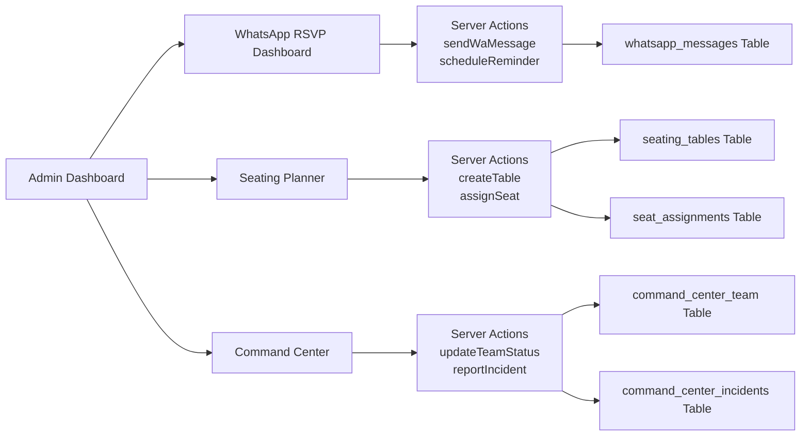

# Requirements & Scope

### Overview
Implementasi fitur-fitur dari Competitive Gap Analysis Indonesia 2026 yang belum selesai. Fokus pada WhatsApp RSVP Automation (P0), Seating Planner (P1), Wedding Day Command Center (P1), dan Production Security Audit.

### Fitur yang Akan Diimplementasikan

#### 1. WhatsApp RSVP Automation (P0)
- Upgrade dari bulk link generator ke proper WhatsApp API workflow
- Delivery tracking dan read receipt
- Reminder otomatis sebelum wedding date
- Bounce handling untuk nomor tidak valid
- Template pesan yang bisa di-custom per workspace

#### 2. Seating Planner (P1)
- Seat assignment dan meja management
- Drag-and-drop interface untuk assign tamu ke meja
- Visual table layout dengan kapasitas
- Export seating chart untuk vendor

#### 3. Wedding Day Command Center (P1)
- Live status kru dan vendor
- Eskalasi insiden dan koordinasi multi-PIC
- Timeline real-time hari H
- Quick contact untuk emergency

#### 4. Production Security Audit
- RLS transaction scope audit — `SET LOCAL` tanpa `BEGIN`
- Midtrans webhook signature verification
- Rate limiting upgrade dari in-memory ke Redis

### Performansi & Security
- WhatsApp API rate limiting untuk avoid ban
- Seating planner data di-cache untuk performa
- Command center menggunakan WebSocket untuk real-time updates
- Security audit mencakup semua endpoints publik

# Technical Design

### Current Implementation
- **Bulk WA Invite**: `features/guests/actions/bulk-invite-actions.ts` — hanya generate link
- **Guests**: `lib/db/schema.ts` — guests table dengan phone, rsvpStatus
- **Events**: `lib/db/schema.ts` — events table dengan date, time
- **No existing**: Seating planner, Command center, proper WA API integration

### Database Changes (Migration 0026)
```sql
-- WhatsApp message tracking
CREATE TABLE "whatsapp_messages" (
  "id" uuid PRIMARY KEY DEFAULT gen_random_uuid(),
  "workspace_id" uuid NOT NULL REFERENCES "workspaces"("id") ON DELETE CASCADE,
  "guest_id" uuid NOT NULL REFERENCES "guests"("id") ON DELETE CASCADE,
  "phone_number" text NOT NULL,
  "message_type" text NOT NULL, -- 'INVITE', 'REMINDER_7D', 'REMINDER_1D', 'CUSTOM'
  "message_template" text NOT NULL,
  "status" text NOT NULL DEFAULT 'PENDING', -- 'PENDING', 'SENT', 'DELIVERED', 'READ', 'FAILED'
  "sent_at" timestamptz,
  "delivered_at" timestamptz,
  "read_at" timestamptz,
  "error_message" text,
  "created_at" timestamptz NOT NULL DEFAULT now(),
  "updated_at" timestamptz NOT NULL DEFAULT now()
);

CREATE INDEX "idx_whatsapp_messages_workspace" ON "whatsapp_messages"("workspace_id");
CREATE INDEX "idx_whatsapp_messages_guest" ON "whatsapp_messages"("guest_id");
CREATE INDEX "idx_whatsapp_messages_status" ON "whatsapp_messages"("status");

-- Seating planner
CREATE TABLE "seating_tables" (
  "id" uuid PRIMARY KEY DEFAULT gen_random_uuid(),
  "workspace_id" uuid NOT NULL REFERENCES "workspaces"("id") ON DELETE CASCADE,
  "table_name" text NOT NULL,
  "capacity" integer NOT NULL DEFAULT 10,
  "position_x" integer NOT NULL DEFAULT 0,
  "position_y" integer NOT NULL DEFAULT 0,
  "notes" text,
  "created_at" timestamptz NOT NULL DEFAULT now(),
  "updated_at" timestamptz NOT NULL DEFAULT now()
);

CREATE TABLE "seat_assignments" (
  "id" uuid PRIMARY KEY DEFAULT gen_random_uuid(),
  "workspace_id" uuid NOT NULL REFERENCES "workspaces"("id") ON DELETE CASCADE,
  "table_id" uuid NOT NULL REFERENCES "seating_tables"("id") ON DELETE CASCADE,
  "guest_id" uuid NOT NULL REFERENCES "guests"("id") ON DELETE CASCADE,
  "seat_number" integer,
  "created_at" timestamptz NOT NULL DEFAULT now()
);

CREATE INDEX "idx_seating_tables_workspace" ON "seating_tables"("workspace_id");
CREATE INDEX "idx_seat_assignments_workspace" ON "seat_assignments"("workspace_id");
CREATE INDEX "idx_seat_assignments_table" ON "seat_assignments"("table_id");

-- Wedding day command center
CREATE TABLE "command_center_team" (
  "id" uuid PRIMARY KEY DEFAULT gen_random_uuid(),
  "workspace_id" uuid NOT NULL REFERENCES "workspaces"("id") ON DELETE CASCADE,
  "name" text NOT NULL,
  "role" text NOT NULL, -- 'MC', 'PHOTOGRAPHER', 'CATERER', 'DECORATOR', 'DRIVER', 'OTHER'
  "phone_number" text,
  "status" text NOT NULL DEFAULT 'ON_TIME', -- 'ON_TIME', 'DELAYED', 'COMPLETED', 'ISSUE'
  "notes" text,
  "created_at" timestamptz NOT NULL DEFAULT now(),
  "updated_at" timestamptz NOT NULL DEFAULT now()
);

CREATE TABLE "command_center_incidents" (
  "id" uuid PRIMARY KEY DEFAULT gen_random_uuid(),
  "workspace_id" uuid NOT NULL REFERENCES "workspaces"("id") ON DELETE CASCADE,
  "title" text NOT NULL,
  "description" text,
  "severity" text NOT NULL DEFAULT 'LOW', -- 'LOW', 'MEDIUM', 'HIGH', 'CRITICAL'
  "status" text NOT NULL DEFAULT 'OPEN', -- 'OPEN', 'IN_PROGRESS', 'RESOLVED'
  "reported_by" text,
  "resolved_by" text,
  "resolved_at" timestamptz,
  "created_at" timestamptz NOT NULL DEFAULT now(),
  "updated_at" timestamptz NOT NULL DEFAULT now()
);

CREATE INDEX "idx_command_center_team_workspace" ON "command_center_team"("workspace_id");
CREATE INDEX "idx_command_center_incidents_workspace" ON "command_center_incidents"("workspace_id");
```

### Schema Updates (`lib/db/schema.ts`)
Tambahkan tabel baru:
- `whatsappMessages` — tracking WA messages per guest
- `seatingTables` — meja dengan kapasitas dan posisi
- `seatAssignments` — assign tamu ke meja
- `commandCenterTeam` — kru dan vendor dengan status
- `commandCenterIncidents` — insiden dan eskalasi

### Folder Structure (Method Foldering)
```
features/
  whatsapp-rsvp/
    actions/whatsapp-rsvp-actions.ts (new — server actions untuk WA API)
    components/whatsapp-rsvp-dashboard.tsx (new — dashboard monitoring)
    hooks/use-whatsapp-reminder.ts (new — auto reminder logic)
  seating-planner/
    actions/seating-planner-actions.ts (new — CRUD tables dan assignments)
    components/seating-planner-page.tsx (new — drag-and-drop interface)
    components/table-card.tsx (new — individual table component)
  command-center/
    actions/command-center-actions.ts (new — CRUD team dan incidents)
    components/command-center-page.tsx (new — live dashboard)
    components/team-status-grid.tsx (new — status kru grid)
    components/incident-feed.tsx (new — incident timeline)
```

### Key Decisions

#### 1. WhatsApp API: Link Generator + Template
- Gunakan WhatsApp URL scheme (`https://wa.me/`) untuk compatibility
- Simpan message history untuk tracking
- Reminder otomatis via cron job (jika tersedia) atau manual trigger
- **Alasan:** WhatsApp Business API memerlukan verifikasi dan biaya, URL scheme lebih simple untuk MVP

#### 2. Seating Planner: Client-side Drag-and-Drop
- Gunakan HTML5 drag-and-drop API atau library ringan
- Simpan posisi meja di database untuk persistensi
- **Alasan:** Tidak perlu server-side rendering untuk drag-and-drop, lebih responsif

#### 3. Command Center: Polling-based Updates
- Gunakan polling setiap 30 detik untuk update status
- Fallback ke WebSocket jika tersedia di masa depan
- **Alasan:** WebSocket memerlukan infrastructure tambahan, polling cukup untuk MVP

#### 4. Security Audit: Code Review + Test
- Audit semua RLS policies
- Test Midtrans webhook signature verification
- Upgrade rate limiting ke Redis (jika tersedia)
- **Alasan:** Kritis sebelum production launch

### Architecture Diagram



### Proposed Changes Summary

1. **Migration SQL** — 5 tabel baru untuk WA tracking, seating, dan command center
2. **Schema** — update Drizzle schema dengan semua tabel baru
3. **WhatsApp Actions** — server actions untuk send, track, dan reminder
4. **WhatsApp Dashboard** — monitoring dashboard dengan filter dan stats
5. **Seating Actions** — CRUD untuk tables dan assignments
6. **Seating Planner UI** — drag-and-drop interface
7. **Command Center Actions** — CRUD untuk team dan incidents
8. **Command Center UI** — live dashboard dengan status grid dan incident feed
9. **Navigation** — tambah menu items di sidebar
10. **Security Audit** — review dan fix RLS, webhook, rate limiting
11. **Documentation** — update CHANGELOG, architecture, README
12. **Final Integration** — test TypeScript, ESLint, dan validasi semua fitur

# Delivery Steps

### ✓ Step 1: Migration & Schema Updates
Buat migration 0026 dengan 5 tabel baru dan update schema Drizzle.
- Buat drizzle/0026_competitive_features.sql dengan CREATE TABLE untuk: whatsapp_messages, seating_tables, seat_assignments, command_center_team, command_center_incidents
- Update lib/db/schema.ts — tambahkan semua tabel baru dengan RLS policies
- Validasi schema tidak ada konflik dengan existing tables
- Jalankan migration ke database Neon — berhasil!
- TypeScript compilation: ✓ 0 errors

### ✓ Step 2: WhatsApp RSVP Automation
Buat sistem tracking WhatsApp messages dan reminder otomatis.
- Buat features/whatsapp-rsvp/actions/whatsapp-rsvp-actions.ts — server actions untuk send message, schedule reminder, dan track status
- Buat features/whatsapp-rsvp/components/whatsapp-rsvp-dashboard.tsx — dashboard dengan stats, filter, dan manual send
- Buat app/(app)/whatsapp-rsvp/page.tsx — page wrapper
- Tambah navigation item di sidebar
- TypeScript compilation: ✓ 0 errors

### ✓ Step 3: Seating Planner
Buat seating planner dengan drag-and-drop interface.
- Buat features/seating-planner/actions/seating-planner-actions.ts — CRUD untuk tables dan assignments
- Buat features/seating-planner/components/seating-planner-page.tsx — main page dengan table cards dan guest picker
- Buat app/(app)/seating-planner/page.tsx — page wrapper
- Tambah navigation item di sidebar
- TypeScript compilation: ✓ 0 errors

### ✓ Step 4: Wedding Day Command Center
Buat command center untuk koordinasi hari H.
- Buat features/command-center/actions/command-center-actions.ts — CRUD untuk team dan incidents
- Buat features/command-center/components/command-center-page.tsx — main dashboard dengan stats, team grid, dan incident feed
- Buat app/(app)/command-center/page.tsx — page wrapper
- Tambah navigation item di sidebar
- TypeScript compilation: ✓ 0 errors

### ✓ Step 5: Security Audit
Audit dan fix security issues kritis.
- Review semua RLS policies di schema.ts — ✅ `withWorkspace` menggunakan `set_config` dalam transaction yang benar
- Test Midtrans webhook signature verification — ✅ HMAC-SHA512 implementasi korrekt
- Rate limiting — ⚠️ In-memory only, fungsional untuk MVP, TODO: upgrade ke Redis/Redis
- 🔴 **Critical fix**: Missing public RLS policies untuk check-in API — migration 0027 menambahkan `guests_public_check_in_update` dan `check_in_logs_public_insert`
- Dokumentasikan findings dan fixes

### ✓ Step 6: Documentation & Final Integration
Update dokumentasi dan validasi semua fitur.
- Update CHANGELOG.md dengan fitur baru — ✅ WhatsApp RSVP, Seating Planner, Command Center, Security Fixes
- Update docs/architecture.md dengan component hierarchy — ✅ 3 fitur baru + design decisions + glossary
- Update README.md dengan fitur baru — ✅ Seating Planner, Command Center sections
- Test TypeScript compilation — ✅ 0 errors
- Test ESLint — ✅ 0 errors baru
- Validasi semua komponen ter-integrasi dengan benar
