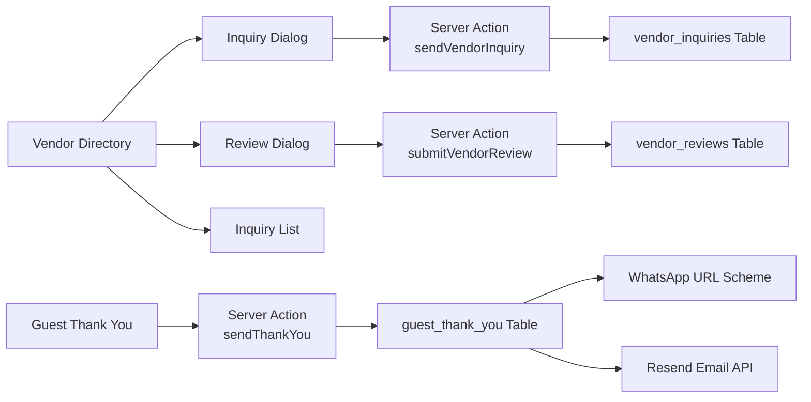

# Final Integration & Polish

### Overview
Menutup semua gap yang tersisa dari implementasi sebelumnya: mengintegrasikan vendor inquiry/review dialogs, memperbaiki guest thank you actual sending, dan menambahkan fitur-fitur pending lainnya.

### Gap yang Akan Ditutup

#### 1. Vendor Inquiry & Review Integration
- Vendor inquiry dan review dialogs sudah dibuat tapi belum terintegrasi
- Tambah tombol "Kirim Inquiry" dan "Review" di setiap vendor card
- Integrasikan ke `curated-vendor-directory.tsx`

#### 2. Guest Thank You Actual Sending
- Saat ini hanya mark as SENT tanpa benar-benar mengirim
- Upgrade untuk generate WhatsApp URL scheme per tamu
- Support email via Resend API (jika RESEND_API_KEY tersedia)

#### 3. Vendor Inquiry List View
- Tambah halaman untuk melihat semua inquiry yang sudah dikirim
- Status tracking: SENT, REPLIED, CLOSED
- Update status inquiry

#### 4. Nikah Berkas Route Page
- Server page untuk nikah berkas belum ada
- Buat `app/(app)/nikah-berkas/page.tsx`

#### 5. Guest Thank You Route Page
- Server page untuk guest thank you belum ada
- Buat `app/(app)/guest-thank-you/page.tsx`

### Performansi & Security
- Rate limiting pada semua server actions
- RLS policies untuk semua tabel
- Input sanitasi untuk semua user input
- Foldering yang rapi per fitur

---

# Technical Design

### Current Implementation
- **Vendor Directory**: `features/vendors/components/curated-vendor-directory.tsx` — 273 lines, sudah ada bookmark dan WhatsApp
- **Vendor Inquiry Dialog**: `features/vendors/components/vendor-inquiry-dialog.tsx` — 154 lines, siap pakai
- **Vendor Review Dialog**: `features/vendors/components/vendor-review-dialog.tsx` — 153 lines, siap pakai
- **Guest Thank You Actions**: `features/guest-thank-you/actions/guest-thank-you-actions.ts` — 180 lines, perlu upgrade send
- **Nikah Berkas Page**: `features/nikah-berkas/components/nikah-berkas-page.tsx` — client component, perlu server page

### Key Decisions

#### 1. Vendor Dialogs: State-based
- Gunakan state `showInquiryDialog` dan `showReviewDialog` di CuratedVendorDirectory
- Store `selectedVendorId` dan `selectedVendorName` untuk dialog props
- **Alasan:** Simple, tidak perlu modal library baru

#### 2. Guest Thank You: WhatsApp URL Scheme
- Generate `wa.me/PHONE?text=MESSAGE` per tamu
- Tampilkan sebagai link yang bisa diklik per tamu
- Untuk email, gunakan Resend API jika tersedia
- **Alasan:** Konsisten dengan WhatsApp RSVP yang sudah ada

#### 3. Vendor Inquiry List: Reusable Table
- Gunakan komponen table yang sudah ada di project
- Tampilkan inquiry history dengan status badges
- **Alasan:** Konsisten dengan UI pattern yang ada

#### 4. Route Pages: Server Pages
- Server page yang fetch data dan render client components
- Pattern yang sudah digunakan di project
- **Alasan:** Konsisten dengan arsitektur yang ada

### Architecture Diagram

### Proposed Changes Summary

1. **Curated Vendor Directory** — Tambah inquiry dan review buttons
2. **Guest Thank You Send** — Upgrade ke WhatsApp URL scheme
3. **Vendor Inquiry List** — Tambah halaman inquiry history
4. **Nikah Berkas Route** — Server page untuk nikah berkas
5. **Guest Thank You Route** — Server page untuk guest thank you
6. **Documentation** — Update CHANGELOG, architecture, README

---

# Delivery Steps

### ✓ Step 1: Vendor Inquiry & Review Integration
Integrasikan vendor inquiry dan review dialogs ke vendor directory.
- Update `curated-vendor-directory.tsx` — tambah state untuk dialogs
- Tambah tombol "Kirim Inquiry" dan "Review" di setiap vendor card
- Render VendorInquiryDialog dan VendorReviewDialog conditional
- Tambah hasReviewedVendor check untuk disable review button jika sudah review

### ✓ Step 2: Guest Thank You Actual Sending
Upgrade guest thank you untuk benar-benar mengirim pesan.
- Update `guest-thank-you-actions.ts` — `sendThankYouAction` generate WhatsApp URL scheme
- Tambah email sending via Resend API jika RESEND_API_KEY tersedia
- Update `guest-thank-you-page.tsx` — tampilkan WhatsApp link per tamu
- Support batch open WhatsApp tabs

### ✓ Step 3: Vendor Inquiry List View
Tambah halaman untuk melihat semua inquiry yang sudah dikirim.
- Buat `features/vendors/components/vendor-inquiry-list.tsx` — table dengan status badges
- Tambah server action untuk update inquiry status
- Tambah navigasi di sidebar atau tab di vendor page

### ✓ Step 4: Nikah Berkas Route Page
Buat server page untuk nikah berkas.
- Buat `app/(app)/nikah-berkas/page.tsx` — server page yang fetch workspace
- Render NikahBerkasPage component
- Tambah navigasi di sidebar jika belum ada

### ✓ Step 5: Guest Thank You Route Page
Buat server page untuk guest thank you.
- Buat `app/(app)/guest-thank-you/page.tsx` — server page yang fetch workspace
- Render GuestThankYouPage component
- Tambah navigasi di sidebar jika belum ada

### ✓ Step 6: Final Validation & Documentation
Validasi semua fitur berfungsi dan update dokumentasi.
- Test TypeScript compilation — 0 errors
- Test ESLint — 0 errors baru
- Validasi semua route pages berfungsi
- Update CHANGELOG.md — tambah section Final Integration
- Update docs/architecture.md — update component hierarchy
- Update README.md — tambah deskripsi fitur baru
