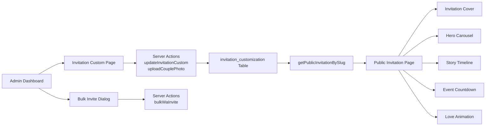

# Requirements & Scope

### Overview
Implementasi lengkap semua fitur undangan digital premium yang belum ada, berdasarkan analisis Attari. Tujuan: membuat undangan Sewaka lebih keren, personal, dan interaktif.

### Fitur yang Akan Diimplementasikan

#### 1. Animasi "Buka Undangan" (Cover Page)
- Halaman cover full-screen dengan animasi masuk
- Tombol "Buka Undangan" yang memicu transisi ke konten utama
- Nama tamu ditampilkan di cover jika ada `?to=NAMA`
- Musik otomatis play setelah buka undangan (browser policy)

#### 2. Love Story Timeline
- Ubah story dari plain text jadi timeline visual dengan milestone
- Field baru: `story_timeline` (JSONB) — `{date, title, description, photo_url}`
- UI: Timeline vertikal dengan foto, tanggal, dan cerita per milestone

#### 3. Custom Font & Background
- Pilihan Google Fonts untuk nama mempelai di hero (Playfair Display, Great Vibes, dll)
- Custom background pattern/image selain default
- Field baru: `custom_font`, `background_image_url`

#### 4. Bulk WhatsApp Invite
- Dari admin dashboard, kirim undangan ke banyak tamu via WA
- Generate pesan template + link personal per tamu
- Checkbox select all / select individual

#### 5. Love Animation (Confetti/Hearts)
- Animasi scroll-triggered: hati, bunga, atau confetti
- CSS animation ringan, tanpa library berat
- Toggle enable/disable di admin

#### 6. Hero Photo Carousel
- Ganti 1 foto couple jadi carousel/slider multiple photos
- Auto-slide dengan manual navigation dots
- Field baru: `hero_photo_urls` (JSONB array)

#### 7. Countdown per Event
- Countdown ke event terdekat yang belum lewat
- Tampilkan countdown terpisah per event di section events

### Performansi & Security
- Lazy load untuk animasi dan carousel
- Google Fonts di-preload dan cached
- Sanitasi input untuk semua field JSONB baru
- Rate limiting pada bulk WhatsApp
- Foldering yang rapi per fitur di `features/` directory

# Technical Design

### Current Implementation
- **Public Invitation**: `features/guests/components/public-invitation-view.tsx` (1039 lines)
- **Admin Page**: `features/invitation-custom/components/invitation-custom-page.tsx` (566 lines)
- **Actions**: `features/invitation-custom/actions/invitation-custom-actions.ts`
- **Schema**: `lib/db/schema.ts` — `invitationCustomization` table
- **Query**: `features/guests/hooks/guest-queries.ts` — `getPublicInvitationBySlug`
- **Page**: `app/invitation/[slug]/page.tsx`

### Database Changes (Migration 0024)
```sql
-- Story timeline: array of {date, title, description, photo_url}
ALTER TABLE "invitation_customization" ADD COLUMN "story_timeline" jsonb;

-- Custom font for hero names (Google Fonts name)
ALTER TABLE "invitation_customization" ADD COLUMN "custom_font" text DEFAULT 'Playfair Display';

-- Custom background image URL
ALTER TABLE "invitation_customization" ADD COLUMN "background_image_url" text;

-- Hero photo carousel: array of blob URLs
ALTER TABLE "invitation_customization" ADD COLUMN "hero_photo_urls" jsonb;

-- Enable love animations (hearts, confetti on scroll)
ALTER TABLE "invitation_customization" ADD COLUMN "enable_animations" boolean DEFAULT false;
```

### Schema Updates (`lib/db/schema.ts`)
Tambahkan field di `invitationCustomization`:
- `storyTimeline: jsonb('story_timeline')`
- `customFont: text('custom_font').default('Playfair Display')`
- `backgroundImageUrl: text('background_image_url')`
- `heroPhotoUrls: jsonb('hero_photo_urls')`
- `enableAnimations: boolean('enable_animations').notNull().default(false)`

### Folder Structure (Method Foldering)
```
features/
  guests/components/
    public-invitation-view.tsx (modified — main component)
    invitation-cover.tsx (new — cover page dengan tombol buka)
    story-timeline.tsx (new — timeline visual)
    hero-carousel.tsx (new — carousel foto hero)
    love-animation.tsx (new — floating hearts/confetti)
    event-countdown.tsx (new — countdown per event)
  invitation-custom/
    actions/invitation-custom-actions.ts (modified — handle new fields)
    components/invitation-custom-page.tsx (modified — admin form)
  guests/
    actions/bulk-invite-actions.ts (new — server action bulk WA)
    components/bulk-invite-dialog.tsx (new — UI dialog, moved from bulk-invite to guests for ESLint zone compliance)
```

### Key Decisions

#### 1. Cover Page: Client-side State
- Gunakan state `isOpened` di `PublicInvitationView`
- Sebelum buka: tampilkan `InvitationCover` full-screen
- Setelah klik: animasi fade-out cover, fade-in konten, play musik
- **Alasan:** Tidak perlu redirect, lebih smooth dan tidak kehilangan state

#### 2. Story Timeline: JSONB di Database
- Format: `[{date, title, description, photo_url}]`
- Admin form: CRUD dynamic rows (tambah/hapus milestone)
- **Alasan:** Fleksibel, tidak perlu tabel baru, konsisten dengan `giftAccounts`

#### 3. Hero Carousel: Blob URLs Array
- Upload multiple photos via admin (gunakan `uploadCouplePhotoAction` yang sudah ada dengan path berbeda)
- Simpan sebagai array blob URLs di `hero_photo_urls`
- Auto-slide 5 detik, dengan dots navigation
- **Alasan:** Reuse upload logic yang ada, simple dan performan

#### 4. Love Animation: Pure CSS
- Floating hearts/bunga yang muncul saat scroll
- CSS keyframes, tanpa library eksternal
- Toggle via `enable_animations` field
- **Alasan:** Ringan, tidak perlu dependensi baru, performan

#### 5. Bulk WhatsApp: Server Action
- Server action yang generate link WA per tamu
- Tampilkan sebagai dialog/modal di admin guest list
- Rate limiting: max 50 invites per batch
- **Alasan:** Security, tidak expose guest data ke client, controlled

#### 6. Countdown per Event: Client-side
- Hitung countdown ke setiap event date di client
- Highlight event yang paling dekat
- **Alasan:** Real-time update tanpa server call, ringan

### Architecture Diagram



### Proposed Changes Summary

1. **Migration SQL** — 5 kolom baru di `invitation_customization`
2. **Schema** — update Drizzle schema
3. **Actions** — handle field baru + bulk WA action
4. **Cover Page** — komponen baru full-screen dengan animasi
5. **Story Timeline** — komponen timeline visual + admin form
6. **Hero Carousel** — komponen carousel + upload multiple photos
7. **Love Animation** — CSS animation component
8. **Event Countdown** — countdown per event
9. **Bulk WhatsApp** — dialog + server action
10. **Admin Form** — tambah sections untuk field baru
11. **Public Page** — integrasi semua komponen baru
12. **Guest Query** — tidak perlu perubahan (sudah fetch semua field)

# Delivery Steps

### ✓ Step 1: Migration & Schema Updates
Tambahkan 5 kolom baru ke invitation_customization dan update schema Drizzle.
- Buat drizzle/0024_invitation_premium_features.sql dengan ALTER TABLE untuk: story_timeline, custom_font, background_image_url, hero_photo_urls, enable_animations
- Update lib/db/schema.ts — tambahkan field baru di invitationCustomization table
- Jalankan migration ke database Neon
- Validasi kolom baru ada di database

### ✓ Step 2: Cover Page - Animasi Buka Undangan
Buat halaman cover full-screen dengan tombol "Buka Undangan" dan transisi animasi.
- Buat features/guests/components/invitation-cover.tsx — cover dengan nama tamu, nama couple, dan tombol buka
- Tambahkan state isOpened di public-invitation-view.tsx
- Sebelum buka: tampilkan InvitationCover, setelah klik: animasi fade-out cover dan fade-in konten
- Play musik otomatis setelah buka undangan (memenuhi browser autoplay policy)
- Update app/invitation/[slug]/page.tsx jika perlu untuk struktur wrapper

### ✓ Step 3: Love Story Timeline
Ubah story dari plain text jadi timeline visual dengan milestone interaktif.
- Buat features/guests/components/story-timeline.tsx — timeline vertikal dengan foto, tanggal, dan cerita
- Update admin form di invitation-custom-page.tsx — CRUD dynamic rows untuk timeline milestones
- Update invitation-custom-actions.ts — parse dan save storyTimeline JSONB
- Ganti section story di public-invitation-view.tsx dengan StoryTimeline component
- Format JSONB: [{date, title, description, photo_url}]
- Support fallback ke plain text story jika timeline kosong

### ✓ Step 4: Hero Photo Carousel
Ganti 1 foto couple jadi carousel/slider multiple photos dengan auto-slide.
- Buat features/guests/components/hero-carousel.tsx — carousel dengan dots navigation dan auto-slide 5 detik
- Tambah upload action untuk multiple hero photos (reuse uploadCouplePhotoAction dengan path hero-photo/)
- Update admin form — gallery picker atau upload baru untuk hero photos
- Update public-invitation-view.tsx hero section — ganti single img dengan HeroCarousel
- Field hero_photo_urls: JSONB array of blob URLs

### ✓ Step 5: Custom Font, Background & Love Animation
Tambah customisasi font Google Fonts, background image, dan animasi scroll-triggered.
- Buat features/guests/components/love-animation.tsx — floating hearts/bunga CSS animation
- Tambah Google Fonts preload di app/invitation/[slug]/page.tsx (Playfair Display, Great Vibes, dll)
- Update public-invitation-view.tsx: apply custom font pada hero names, custom background, render LoveAnimation
- Update admin form — dropdown pilih font, upload background image, toggle enable animations
- Update invitation-custom-actions.ts — handle customFont, backgroundImageUrl, enableAnimations

### ✓ Step 6: Countdown per Event
Tambah countdown timer terpisah untuk setiap event, highlight event terdekat.
- Buat features/guests/components/event-countdown.tsx — countdown component per event
- Update section events di public-invitation-view.tsx — tampilkan countdown di setiap event card
- Highlight event yang paling dekat dengan sekarang
- Fallback ke countdown wedding_date yang sudah ada untuk section utama

### ✓ Step 7: Bulk WhatsApp Invite
Tambah fitur kirim undangan ke banyak tamu via WhatsApp dari admin.
- Buat features/bulk-invite/actions/bulk-invite-actions.ts — server action, generate link WA per tamu, rate limit 50/batch
- Buat features/bulk-invite/components/bulk-invite-dialog.tsx — dialog dengan checkbox select, preview pesan, dan tombol kirim
- Integrasikan ke halaman guest list admin (cari halaman guest management yang ada)
- Template pesan personal per tamu dengan link ?to=NAMA
- Security: validasi workspace access, sanitasi input

### ✓ Step 8: Run Migration & Final Integration
Jalankan migration, integrasi final, dan validasi semua fitur.
- Jalankan migration 0024 ke database
- Update guest-queries.ts jika perlu untuk field baru (seharusnya sudah ter-cover karena select *)
- Test TypeScript compilation — 0 errors
- Test ESLint — 0 errors baru
- Validasi semua komponen ter-integrasi dengan benar di public-invitation-view.tsx
- Test admin form save dan load untuk semua field baru
- Cleanup dan formatting