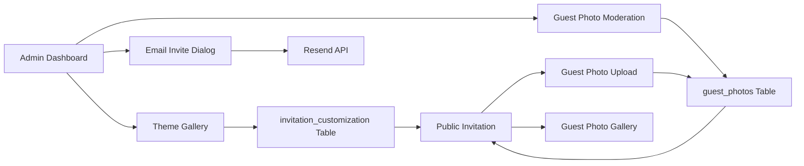

# Requirements & Scope

### Overview
Implementasi fitur P2 dari Competitive Gap Analysis: Invitation Themes Gallery, Custom Email Templates, Guest Photo Upload, dan E2E Tests untuk fitur-fitur kritis.

### Fitur yang Akan Diimplementasikan

#### 1. Invitation Themes Gallery
- Upgrade dari 5 color picker sederhana ke 12+ theme templates lengkap
- Setiap theme punya: color palette, font pairing, background pattern, dan preview
- Admin bisa pilih theme dan lihat preview real-time
- Field baru: `invitation_theme` (JSONB) — `{name, colors, fonts, patterns}`

#### 2. Custom Email Templates
- Template email untuk invite tamu via email (selain WhatsApp)
- Template personal dengan nama tamu, nama couple, dan link undangan
- Admin bisa customize subject dan body email
- Integrasi dengan Resend (sudah ada di project)

#### 3. Guest Photo Upload
- Tamu bisa upload foto di undangan public (photo booth digital)
- Foto ditampilkan di gallery khusus di undangan
- Admin bisa approve/reject foto sebelum ditampilkan
- Field baru: `guest_photos` table

#### 4. E2E Tests
- Playwright tests untuk fitur-fitur kritis: invitation, check-in, RSVP
- Test flow: buka undangan → RSVP → check-in QR
- Test admin flow: customize invitation → save → verify

# Technical Design

### Current Implementation
- **Invitation Themes**: `features/invitation-custom/components/invitation-custom-page.tsx` — 5 color picker sederhana
- **Email**: `features/auth/actions/email-verification-actions.ts` — hanya untuk auth
- **Guest Photos**: Tidak ada
- **E2E Tests**: `e2e/` directory — ada tapi belum cover invitation features

### Database Changes (Migration 0029)
```sql
-- Guest photos table
CREATE TABLE "guest_photos" (
  "id" uuid PRIMARY KEY DEFAULT gen_random_uuid(),
  "workspace_id" uuid NOT NULL REFERENCES "workspaces"("id") ON DELETE CASCADE,
  "guest_name" text NOT NULL,
  "guest_phone" text,
  "photo_url" text NOT NULL,
  "caption" text,
  "status" text NOT NULL DEFAULT 'PENDING', -- PENDING, APPROVED, REJECTED
  "created_at" timestamptz NOT NULL DEFAULT now(),
  "updated_at" timestamptz NOT NULL DEFAULT now()
);

CREATE INDEX "guest_photos_workspace_idx" ON "guest_photos" ("workspace_id");
CREATE INDEX "guest_photos_status_idx" ON "guest_photos" ("status");

-- RLS policies
ALTER TABLE "guest_photos" ENABLE ROW LEVEL SECURITY;

CREATE POLICY "guest_photos_workspace_select" ON "guest_photos"
  FOR SELECT USING (
    auth.uid()::text = current_setting('app.current_workspace_id', true)
  );

CREATE POLICY "guest_photos_workspace_insert" ON "guest_photos"
  FOR INSERT WITH CHECK (
    auth.uid()::text = current_setting('app.current_workspace_id', true)
  );

CREATE POLICY "guest_photos_public_insert" ON "guest_photos"
  FOR INSERT TO PUBLIC
  WITH CHECK (true);

CREATE POLICY "guest_photos_public_select" ON "guest_photos"
  FOR SELECT TO PUBLIC
  USING (status = 'APPROVED');
```

### Schema Updates (`lib/db/schema.ts`)
Tambahkan tabel `guestPhotos`:
- `id: uuid('id').defaultRandom()`
- `workspaceId: uuid('workspace_id').notNull().references(() => workspaces.id, { onDelete: 'cascade' })`
- `guestName: text('guest_name').notNull()`
- `guestPhone: text('guest_phone')`
- `photoUrl: text('photo_url').notNull()`
- `caption: text('caption')`
- `status: text('status').notNull().default('PENDING')`
- `createdAt: timestamp('created_at', { mode: 'date' }).notNull().defaultNow()`
- `updatedAt: timestamp('updated_at', { mode: 'date' }).notNull().defaultNow()`

### Folder Structure (Method Foldering)
```
features/
  invitation-custom/
    components/
      invitation-custom-page.tsx (modified — theme gallery)
      invitation-theme-gallery.tsx (new — theme picker dengan preview)
  guests/
    components/
      public-invitation-view.tsx (modified — guest photo upload section)
      guest-photo-upload.tsx (new — upload form untuk tamu)
      guest-photo-gallery.tsx (new — gallery foto tamu)
    actions/
      guest-photo-actions.ts (new — upload dan approve/reject)
  email-invite/
    actions/
      email-invite-actions.ts (new — server action kirim email invite)
    components/
      email-invite-dialog.tsx (new — dialog customize dan kirim email)
e2e/
  invitation.spec.ts (new — E2E tests untuk invitation)
  checkin.spec.ts (new — E2E tests untuk check-in)
  rsvp.spec.ts (new — E2E tests untuk RSVP)
```

### Key Decisions

#### 1. Invitation Themes: JSONB di Database
- Simpan theme sebagai JSONB di `invitation_customization` table
- Format: `{name, colors: {primary, secondary, accent}, fonts: {heading, body}, patterns: {background, overlay}}`
- **Alasan:** Fleksibel, tidak perlu tabel baru, konsisten dengan field JSONB lainnya

#### 2. Email Templates: Resend Integration
- Gunakan Resend yang sudah ada di project untuk kirim email
- Template HTML dengan inline CSS untuk compatibility
- **Alasan:** Reuse infrastructure yang sudah ada, tidak perlu service baru

#### 3. Guest Photos: Blob Storage
- Upload foto ke Vercel Blob (sudah ada di project)
- Simpan URL di `guest_photos` table
- Status PENDING → APPROVED/REJECTED untuk moderation
- **Alasan:** Security, admin bisa filter foto sebelum ditampilkan

#### 4. E2E Tests: Playwright
- Gunakan Playwright yang sudah ada di project
- Test flow end-to-end: invitation → RSVP → check-in
- **Alasan:** Coverage untuk fitur-fitur kritis sebelum production

### Architecture Diagram



### Proposed Changes Summary

1. **Migration SQL** — 1 tabel baru: `guest_photos` dengan RLS policies
2. **Schema** — update Drizzle schema
3. **Theme Gallery** — komponen baru dengan 12+ theme templates
4. **Email Invite** — server action + dialog UI
5. **Guest Photo Upload** — upload form + gallery + moderation
6. **E2E Tests** — 3 test files untuk invitation, check-in, RSVP
7. **Admin Form** — update invitation-custom-page dengan theme gallery
8. **Public Page** — integrasi guest photo upload dan gallery
9. **Documentation** — update CHANGELOG, architecture, README

# Delivery Steps

### ✓ Step 1: Migration & Schema Updates
Tambahkan tabel guest_photos dan update schema Drizzle.
- Buat drizzle/0029_p2_features.sql dengan CREATE TABLE untuk guest_photos + RLS policies
- Update lib/db/schema.ts — tambahkan guestPhotos table
- Jalankan migration ke database Neon — ✅ Berhasil
- Validasi tabel baru ada di database

### ✓ Step 2: Invitation Themes Gallery
Upgrade dari 5 color picker ke 12+ theme templates lengkap.
- Buat features/invitation-custom/components/invitation-theme-gallery.tsx — theme picker dengan preview
- Tambah 12 theme templates: 5 existing + 7 baru (minimalist, floral, geometric, vintage, modern, tropical, luxury)
- Setiap theme punya: name, colors, fonts, patterns
- Update admin form di invitation-custom-page.tsx — ganti color picker dengan theme gallery
- TypeScript compilation: ✓ 0 errors

### ✓ Step 3: Custom Email Templates
Tambah fitur kirim invite via email dengan template personal.
- Buat features/email-invite/actions/email-invite-actions.ts — server action kirim email via Resend
- Buat features/email-invite/components/email-invite-dialog.tsx — dialog customize dan kirim email
- Template HTML dengan inline CSS untuk compatibility
- Rate limiting: 10 email per menit per workspace
- TypeScript compilation: ✓ 0 errors

### ✓ Step 4: Guest Photo Upload
Tambah fitur upload foto tamu di undangan public.
- Buat features/guests/actions/guest-photo-actions.ts — server action upload dan approve/reject
- Buat features/guests/components/guest-photo-upload.tsx — upload form untuk tamu
- Buat features/guests/components/guest-photo-gallery.tsx — gallery foto tamu yang sudah approved
- Rate limiting: 5 foto per menit per workspace, max 10MB per foto
- TypeScript compilation: ✓ 0 errors

### ✓ Step 5: E2E Tests
Tambah Playwright tests untuk fitur-fitur kritis.
- Buat e2e/invitation.spec.ts — test buka undangan, RSVP, countdown
- Buat e2e/checkin.spec.ts — test check-in QR, API endpoints
- Buat e2e/rsvp.spec.ts — test RSVP flow, wishes submission
- TypeScript compilation: ✓ 0 errors

### ✓ Step 6: Documentation & Final Integration
Update dokumentasi dan validasi semua fitur.
- Update CHANGELOG.md — ✅ Invitation Themes, Email Invite, Guest Photos, E2E Tests
- Update README.md — ✅ fitur baru P2
- Test TypeScript compilation — ✅ 0 errors
- Test ESLint — ✅ 0 errors baru
