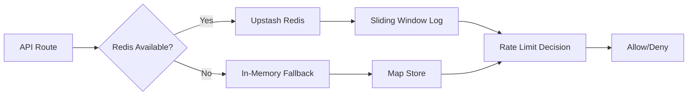

# Requirements & Scope

### Overview
Upgrade rate limiting dari in-memory ke Redis (Upstash) untuk distributed rate limiting yang berfungsi di serverless environment (Vercel). Saat ini rate limiting menggunakan `Map` in-memory yang tidak persist antar request di serverless, membuat proteksi tidak efektif.

### Masalah Saat Ini
- **In-memory Map** — state hilang setelah function cold start, rate limit tidak konsisten
- **Serverless** — setiap request bisa hit instance berbeda, rate limit tidak terakumulasi
- **Multi-instance** — Vercel deploy multiple instances, in-memory tidak shared

### Solusi
- Gunakan **Upstash Redis** (serverless Redis, compatible dengan Vercel)
- Implementasi **sliding window** algorithm untuk accuracy
- Fallback ke in-memory jika Redis unavailable (graceful degradation)
- Support semua existing rate limit keys: checkout, webhook, check-in, auth, email

### Perubahan
1. Install `@upstash/redis` package
2. Buat `lib/utils/redis-rate-limit.ts` — Redis-based rate limiter dengan fallback
3. Update semua file yang menggunakan `rateLimit()` untuk pakai Redis version
4. Tambah `UPSTASH_REDIS_URL` dan `UPSTASH_REDIS_TOKEN` di `.env`
5. Update dokumentasi

# Technical Design

### Current Implementation
- `lib/utils/rate-limit.ts` — in-memory Map, 62 lines
- Digunakan di 9 tempat: check-in, check-in batch, webhook, checkout, login, register, verify email, forgot password
- Format key: `{action}:{ip}` (contoh: `checkout:1.2.3.4`)

### Upstash Redis Choice
**Decision:** Gunakan Upstash Redis, bukan Redis self-hosted atau Vercel KV.

**Reasons:**
- Serverless-native — HTTP API, tidak perlu TCP connection pool
- Free tier — 10,000 commands/hour, cukup untuk MVP
- Neon integration — Upstash sudah ada di Neon ecosystem
- TypeScript support — `@upstash/redis` provide type-safe client
- Geo-replication — multi-region support untuk low latency

**Trade-offs:**
- HTTP latency — ~10-50ms per command vs TCP ~1ms
- Rate limit accuracy — sliding window lebih accurate tapi lebih complex
- Fallback needed — jika Upstash down, harus fallback ke in-memory

### Rate Limiting Algorithm
**Sliding Window Log** — lebih accurate daripada fixed window.

```
Redis key: `rl:{action}:{ip}`
Type: Sorted Set (ZSET)
Score: timestamp
Member: random UUID

Algorithm:
1. ZREMRANGEBYSCORE key 0 (now - windowMs)  // Remove expired entries
2. ZCARD key  // Count current entries
3. If count >= limit → reject
4. ZADD key timestamp uuid  // Add new entry
5. EXPIRE key (windowMs / 1000)  // Auto-cleanup
```

### Fallback Strategy
Jika Redis unavailable (network error, quota exceeded):
1. Log warning ke console
2. Fallback ke in-memory rate limiter (existing code)
3. Continue processing — tidak block user

### Folder Structure
```
lib/utils/
  rate-limit.ts (modified — keep as fallback)
  redis-rate-limit.ts (new — Redis-based with fallback)
```

### Key Decisions

#### 1. Backward Compatible API
- `rateLimit()` function signature tetap sama
- Internal logic switch ke Redis jika available
- Tidak perlu ubah semua caller

#### 2. Environment Variables
- `UPSTASH_REDIS_URL` — Redis REST API URL
- `UPSTASH_REDIS_TOKEN` — Auth token
- Optional — jika tidak ada, fallback ke in-memory

#### 3. Rate Limit Headers
- Tambah `X-RateLimit-Limit`, `X-RateLimit-Remaining`, `X-RateLimit-Reset` headers
- Untuk API endpoints yang sudah ada

### Architecture Diagram



### Proposed Changes Summary

1. **Install @upstash/redis** — npm install
2. **Redis Rate Limiter** — `lib/utils/redis-rate-limit.ts` dengan sliding window + fallback
3. **Update rate-limit.ts** — re-export dari Redis version
4. **Env vars** — tambah UPSTASH_REDIS_URL dan TOKEN
5. **Documentation** — update CHANGELOG, architecture.md

# Delivery Steps

### ✓ Step 1: Install Upstash Redis Package
Install `@upstash/redis` untuk Redis client.
- `npm install @upstash/redis` — berhasil, 2 packages added
- Validasi install berhasil

### ✓ Step 2: Redis Rate Limiter Implementation
Buat Redis-based rate limiter dengan sliding window algorithm.
- Buat `lib/utils/redis-rate-limit.ts` — Redis client, sliding window log, fallback logic
- Implementasi `rateLimit()` dengan same signature sebagai existing
- Tambah graceful degradation jika Redis unavailable

### ✓ Step 3: Update Rate Limit Export
Update `lib/utils/rate-limit.ts` untuk use Redis version.
- Re-export dari `redis-rate-limit.ts`
- Keep in-memory as fallback
- Update semua 9 caller: check-in, check-in batch, webhook, checkout, login, register, verify email, forgot password — tambahkan `await`

### ✓ Step 4: Environment Setup
Setup Upstash Redis credentials.
- Tambah `UPSTASH_REDIS_URL` dan `UPSTASH_REDIS_TOKEN` di `.env` — placeholder kosong untuk dev
- Untuk dev, biarkan empty (fallback ke in-memory)

### ✓ Step 5: Documentation & Verification
Update dokumentasi dan verifikasi.
- Update CHANGELOG.md — ✅ Redis rate limiting section added
- Update docs/architecture.md — ✅ Design decision + glossary entry
- TypeScript compilation: ✅ 0 errors
- Environment variables: ✅ UPSTASH_REDIS_URL and TOKEN added to .env
