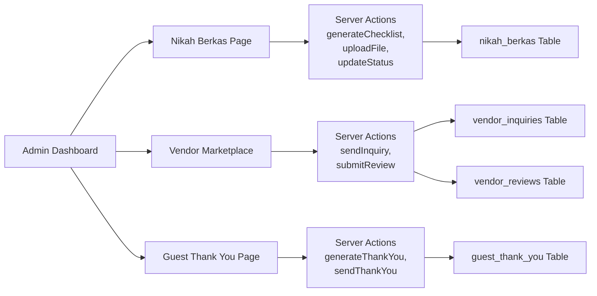

# Remaining Gaps - Competitive Gap Analysis Implementation

### Overview
Implementasi 3 gap terakhir dari Competitive Gap Analysis Indonesia 2026 yang belum ada: Berkas Nikah KUA/Catatan Sipil, Vendor Marketplace Enhancement, dan Guest Thank You Automation.

### Fitur yang Akan Diimplementasikan

#### 1. Berkas Nikah KUA/Catatan Sipil (P1)
- Modul dokumen administratif pernikahan Indonesia
- Checklist adaptif berdasarkan jenis nikah (Nikah Sipil, Nikah Agama, Nikah KUA)
- Upload berkas privat per dokumen
- Deadline tracking dan pengingat otomatis
- Status progress per dokumen

#### 2. Vendor Marketplace Enhancement (P1)
- Inquiry system ke vendor dari dashboard
- Review dan rating vendor setelah layanan
- Profil publik vendor terverifikasi
- Filter vendor berdasarkan kategori, lokasi, dan rating

#### 3. Guest Thank You Automation (P2)
- Otomatis kirim ucapan terima kasih ke tamu setelah wedding
- Template pesan personal per tamu
- Support WhatsApp dan email
- Schedule pengirimannya

### Performansi & Security
- RLS policies untuk semua tabel baru
- Rate limiting pada inquiry dan thank you
- Input sanitasi untuk semua user input
- Foldering yang rapi per fitur

---

# Technical Design

### Current Implementation
- **Documents**: `features/documents/` — sudah ada document management umum
- **Vendors**: `features/vendors/` — sudah ada vendor CRUD dan curated vendors
- **Guests**: `features/guests/` — sudah ada guest management dan RSVP
- **WhatsApp**: `features/whatsapp-rsvp/` — sudah ada WhatsApp message tracking
- **Email**: `features/email-invite/` — sudah ada email template dan server action

### Database Changes (Migration 0030)

```sql
-- Nikah Berkas: checklist dokumen administratif
CREATE TABLE "nikah_berkas" (
  "id" uuid PRIMARY KEY DEFAULT gen_random_uuid(),
  "workspace_id" uuid NOT NULL REFERENCES "wedding_workspaces"("id") ON DELETE CASCADE,
  "nikah_type" text NOT NULL, -- 'SIPIL', 'AGAMA', 'KUA'
  "document_name" text NOT NULL,
  "document_description" text,
  "is_required" boolean NOT NULL DEFAULT true,
  "is_completed" boolean NOT NULL DEFAULT false,
  "file_url" text,
  "notes" text,
  "deadline_date" date,
  "completed_at" timestamptz,
  "created_at" timestamptz NOT NULL DEFAULT now(),
  "updated_at" timestamptz NOT NULL DEFAULT now()
);

CREATE INDEX "nikah_berkas_workspace_idx" ON "nikah_berkas" ("workspace_id");
CREATE INDEX "nikah_berkas_nikah_type_idx" ON "nikah_berkas" ("nikah_type");

-- Vendor inquiries: pesan ke vendor dari dashboard
CREATE TABLE "vendor_inquiries" (
  "id" uuid PRIMARY KEY DEFAULT gen_random_uuid(),
  "workspace_id" uuid NOT NULL REFERENCES "wedding_workspaces"("id") ON DELETE CASCADE,
  "vendor_id" uuid NOT NULL REFERENCES "curated_vendors"("id") ON DELETE CASCADE,
  "message" text NOT NULL,
  "contact_method" text NOT NULL DEFAULT 'EMAIL', -- 'EMAIL', 'PHONE', 'WHATSAPP'
  "status" text NOT NULL DEFAULT 'SENT', -- 'SENT', 'REPLIED', 'CLOSED'
  "sent_at" timestamptz NOT NULL DEFAULT now(),
  "replied_at" timestamptz,
  "created_at" timestamptz NOT NULL DEFAULT now()
);

CREATE INDEX "vendor_inquiries_workspace_idx" ON "vendor_inquiries" ("workspace_id");
CREATE INDEX "vendor_inquiries_vendor_idx" ON "vendor_inquiries" ("vendor_id");

-- Vendor reviews: rating dan review setelah layanan
CREATE TABLE "vendor_reviews" (
  "id" uuid PRIMARY KEY DEFAULT gen_random_uuid(),
  "workspace_id" uuid NOT NULL REFERENCES "wedding_workspaces"("id") ON DELETE CASCADE,
  "vendor_id" uuid NOT NULL REFERENCES "curated_vendors"("id") ON DELETE CASCADE,
  "rating" integer NOT NULL CHECK (rating >= 1 AND rating <= 5),
  "review_text" text,
  "created_at" timestamptz NOT NULL DEFAULT now()
);

CREATE INDEX "vendor_reviews_vendor_idx" ON "vendor_reviews" ("vendor_id");

-- Guest thank you messages
CREATE TABLE "guest_thank_you" (
  "id" uuid PRIMARY KEY DEFAULT gen_random_uuid(),
  "workspace_id" uuid NOT NULL REFERENCES "wedding_workspaces"("id") ON DELETE CASCADE,
  "guest_id" uuid NOT NULL REFERENCES "guests"("id") ON DELETE CASCADE,
  "message_template" text NOT NULL,
  "message_personalized" text,
  "channel" text NOT NULL DEFAULT 'WHATSAPP', -- 'WHATSAPP', 'EMAIL'
  "status" text NOT NULL DEFAULT 'PENDING', -- 'PENDING', 'SENT', 'FAILED'
  "sent_at" timestamptz,
  "scheduled_for" timestamptz,
  "created_at" timestamptz NOT NULL DEFAULT now()
);

CREATE INDEX "guest_thank_you_workspace_idx" ON "guest_thank_you" ("workspace_id");
CREATE INDEX "guest_thank_you_guest_idx" ON "guest_thank_you" ("guest_id");
```

### Schema Updates (`lib/db/schema.ts`)
Tambahkan tabel baru:
1. `nikahBerkas` — dokumen administratif pernikahan
2. `vendorInquiries` — inquiry ke vendor
3. `vendorReviews` — review dan rating vendor
4. `guestThankYou` — thank you messages ke tamu

### Folder Structure (Method Foldering)
```
features/
  nikah-berkas/
    actions/nikah-berkas-actions.ts (new — CRUD + generate checklist)
    components/nikah-berkas-page.tsx (new — UI management)
  vendors/
    actions/vendor-inquiry-actions.ts (new — inquiry + review)
    components/vendor-inquiry-dialog.tsx (new — inquiry form)
    components/vendor-review-dialog.tsx (new — review form)
  guest-thank-you/
    actions/guest-thank-you-actions.ts (new — generate + send)
    components/guest-thank-you-page.tsx (new — UI management)
```

### Key Decisions

#### 1. Nikah Berkas: Per Workspace
- Setiap workspace punya checklist sendiri
- Generate dari template berdasarkan jenis nikah
- Support upload file ke Vercel Blob storage
- **Alasan:** Setiap pernikahan punya kebutuhan dokumen berbeda

#### 2. Vendor Inquiry: Email/WhatsApp/Phone
- Gunakan existing email action untuk inquiry via email
- Untuk WhatsApp, gunakan URL scheme (wa.me)
- Track status inquiry di database
- **Alasan:** Fleksibel, tidak perlu API vendor

#### 3. Vendor Review: Rating + Text
- Rating 1-5 bintang, optional review text
- Satu review per workspace per vendor
- Tampilkan rata-rata rating di vendor card
- **Alasan:** Konsisten dengan pattern review umum

#### 4. Guest Thank You: Template + Personal
- Template message dengan placeholder {guestName}, {coupleName}
- Generate batch untuk semua tamu yang RSVP
- Support WhatsApp dan email channel
- **Alasan:** Personal tapi efisien

### Architecture Diagram



### Proposed Changes Summary

1. **Migration SQL** — 4 tabel baru: nikah_berkas, vendor_inquiries, vendor_reviews, guest_thank_you
2. **Schema** — update Drizzle schema dengan 4 tabel baru
3. **Nikah Berkas Actions** — generate checklist, upload file, update status
4. **Nikah Berkas UI** — page dengan filter, progress bar, dan file upload
5. **Vendor Inquiry Actions** — send inquiry, submit review
6. **Vendor Inquiry UI** — dialog inquiry di vendor card
7. **Vendor Review UI** — dialog review di vendor card
8. **Guest Thank You Actions** — generate batch, send messages
9. **Guest Thank You UI** — page dengan template editor dan send button
10. **Navigation** — tambah menu di sidebar
11. **Documentation** — update CHANGELOG, architecture, README

---

# Delivery Steps

### ✓ Step 1: Migration & Schema Updates
Buat migration 0030 dan update Drizzle schema.
- Buat drizzle/0030_remaining_gaps.sql dengan 4 tabel baru + index + RLS policies
- Update lib/db/schema.ts — tambahkan nikahBerkas, vendorInquiries, vendorReviews, guestThankYou
- Jalankan migration ke database Neon
- Validasi tabel baru ada di database

### ✓ Step 2: Berkas Nikah KUA/Catatan Sipil
Buat modul dokumen administratif pernikahan lengkap.
- Buat features/nikah-berkas/actions/nikah-berkas-actions.ts — generate checklist, upload file, update status
- Buat features/nikah-berkas/components/nikah-berkas-page.tsx — UI dengan filter, progress, dan file upload
- Tambah template checklist per jenis nikah (SIPIL, AGAMA, KUA) di lib/constants/
- Tambah navigasi di sidebar
- Security: validasi workspace access, sanitasi input

### ✓ Step 3: Vendor Marketplace Enhancement
Tambah inquiry system dan review/rating vendor.
- Buat features/vendors/actions/vendor-inquiry-actions.ts — send inquiry dan submit review
- Buat features/vendors/components/vendor-inquiry-dialog.tsx — form inquiry dengan pesan custom
- Buat features/vendors/components/vendor-review-dialog.tsx — form review dengan rating bintang
- Update vendor card di vendor list untuk tampilkan inquiry button dan review
- Tampilkan rata-rata rating di vendor card

### ✓ Step 4: Guest Thank You Automation
Buat fitur otomatis kirim ucapan terima kasih ke tamu.
- Buat features/guest-thank-you/actions/guest-thank-you-actions.ts — generate batch dan send messages
- Buat features/guest-thank-you/components/guest-thank-you-page.tsx — UI dengan template editor dan send button
- Support WhatsApp dan email channel
- Template message dengan placeholder personal
- Tambah navigasi di sidebar

### ✓ Step 5: Navigation & Documentation
Tambah navigasi dan update dokumentasi.
- Update components/layout/app-sidebar.tsx — tambah 3 menu item baru
- Update CHANGELOG.md — tambah section untuk 3 fitur baru
- Update docs/architecture.md — tambah component hierarchy dan design decisions
- Update README.md — tambah deskripsi fitur baru

### ✓ Step 6: Final Validation & Testing
Validasi semua fitur berfungsi dengan benar.
- Test TypeScript compilation — 0 errors
- Test ESLint — 0 errors baru
- Validasi semua komponen ter-integrasi dengan benar
- Test server actions — generate checklist, send inquiry, submit review, send thank you
- Cleanup dan formatting
