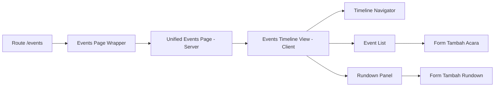

# Requirements

**Tujuan:** Menyatukan tiga halaman yang tumpang tindih — Acara & Rundown, Timeline, dan Hari Pernikahan — menjadi satu halaman "Rangkaian Acara" yang jelas dan mudah digunakan.

**Masalah saat ini:**
- **Acara & Rundown** (`/events`): Menampilkan rundown adat + daftar acara + form tambah
- **Timeline** (`/timeline`): Menampilkan events dan rundowns sebagai timeline vertikal, hanya view
- **Hari Pernikahan** (`/wedding-day`): Menampilkan hanya rundowns dengan detail waktu

Ketiga halaman menampilkan data yang sama (`wedding_events` + `cultural_rundowns`) dengan tampilan berbeda. User bingung mana yang dipakai.

**Solusi:** Satu halaman "Rangkaian Acara" dengan:
1. **Timeline Navigator** di atas — scroll horizontal untuk navigasi cepat antar tanggal
2. **Daftar Acara** di tengah — acara-acara di tanggal terpilih
3. **Rundown Detail** di bawah — slot waktu dan detail acara yang dipilih

**Out of Scope:**
- Tidak mengubah struktur database (`wedding_events` dan `cultural_rundowns` tetap digunakan)
- Tidak mengubah data yang sudah ada
- Checklist Persiapan (`/tasks`) tetap terpisah karena fungsinya berbeda (tugas persiapan, bukan jadwal acara)

# Technical Design

### Implementasi Saat Ini

**Tabel Database:**
- `wedding_events`: id, workspaceId, name, eventDate, location, notes
- `cultural_rundowns`: id, workspaceId, eventId (FK ke events), title, ceremonyType, timeStart, timeEnd, picName, location, attire, rituals, notes, sortOrder

**Halaman yang ada:**
- `features/events/components/events-page-content.tsx` — Rundown adat + daftar acara + form tambah
- `features/timeline/components/timeline-page-content.tsx` — Timeline vertikal events + rundowns
- `features/wedding-day/components/wedding-day-page-content.tsx` — Rundowns dengan detail waktu

**Query yang ada:**
- `listWorkspaceEvents(workspaceId)` dari `features/events/hooks/event-queries.ts`
- `listWorkspaceRundowns(workspaceId)` dari `features/rundown/hooks/rundown-queries.ts`

### Keputusan Kunci

**1. Struktur Halaman: Timeline Navigator + Event List + Rundown Panel**

Timeline horizontal di atas untuk navigasi tanggal, daftar acara di tengah, rundown detail di bawah. User bisa klik tanggal → lihat acara di tanggal itu → klik acara → lihat rundown detailnya.

**2. Client Component untuk interaktivitas**

Halaman baru akan menggunakan `"use client"` karena perlu state management untuk tanggal terpilih, acara terpilih, dan filter. Data tetap di-fetch di Server Component wrapper lalu dipassing sebagai props.

**3. Pertahankan form tambah acara dan rundown**

Form tambah acara dari halaman lama dipertahankan. Form tambah rundown juga ditambahkan inline di panel rundown detail.

**4. Hapus halaman Timeline dan Wedding Day**

Setelah halaman terunifikasi selesai, halaman `/timeline` dan `/wedding-day` dihapus. Sidebar diperbarui untuk hanya menampilkan "Rangkaian Acara".

### Perubahan yang Diusulkan

**File Baru:**
- `features/events/components/unified-events-page.tsx` — Server Component wrapper yang fetch data
- `features/events/components/events-timeline-view.tsx` — Client Component utama dengan timeline navigator, event list, dan rundown panel

**File yang Diubah:**
- `app/(app)/events/page.tsx` — Menggunakan komponen baru
- `components/layout/app-sidebar.tsx` — Menghapus menu Timeline dan Hari Pernikahan

**File yang Dihapus:**
- `app/(app)/timeline/page.tsx`
- `features/timeline/`
- `app/(app)/wedding-day/page.tsx`
- `features/wedding-day/`

### Arsitektur

### Alur Penggunaan

1. User buka `/events` → melihat semua tanggal yang punya acara di timeline navigator
2. Klik tanggal → daftar acara di tanggal tersebut muncul
3. Klik acara → rundown detail (slot waktu, PIC, lokasi, busana) muncul di panel bawah
4. Tambah acara baru via form di panel event list
5. Tambah rundown via form di panel rundown (terhubung ke acara yang dipilih)

# Delivery Steps

### ✓ Step 1: Buat halaman Rangkaian Acara terunifikasi
Membuat halaman baru `/events` dengan timeline navigator horizontal di atas, daftar acara di tengah, dan panel rundown detail di bawah.

### ✓ Step 2: Hapus halaman lama dan perbarui sidebar
Menghapus halaman lama dan memperbarui navigasi sidebar.

### ✓ Step 3: Tambah tabel `invitation_customization` dan migrasi
Menambahkan tabel baru untuk menyimpan setting custom undangan per workspace.

- Tambah tabel `invitation_customization` di `lib/db/schema.ts` dengan kolom: id, workspaceId (unique FK), couplePhotoUrl, theme, musicUrl, story, galleryImageIds (JSON), enabled, createdAt, updatedAt
- Buat file migrasi `drizzle/0022_invitation_customization.sql`
- Tambah relations di schema
- Migrasi perlu dijalankan manual (database connection timeout)

### ✓ Step 4: Buat halaman Custom Undangan
Halaman baru untuk user mengatur custom undangan: foto, tema, musik, cerita, galeri.

- Buat `features/invitation-custom/actions/invitation-custom-actions.ts`: Server action `updateInvitationCustomAction` dan `uploadCouplePhotoAction`
- Buat `features/invitation-custom/hooks/invitation-custom-queries.ts`: Query `getInvitationCustomByWorkspace`
- Buat `features/invitation-custom/components/invitation-custom-page.tsx`: Client component dengan form lengkap
- Buat `app/(app)/invitation/custom/page.tsx`: Route page
- Tambah menu "Custom Undangan" di sidebar kategori ACARA

### ✓ Step 5: Integrasikan custom undangan ke undangan publik
Undangan publik membaca setting custom dan menyesuaikan tampilannya.

- Update `getPublicInvitationBySlug()` untuk join dengan `invitation_customization` dan `image_gallery`
- Update `PublicInvitationView`: hero background foto couple, teks putih di atas foto, cerita cinta, galeri foto, musik player
- Update `app/invitation/[slug]/page.tsx`: Tambah prop custom dan customGalleryImages

### ✓ Step 6: Buat Executive Summary PDF
Halaman baru untuk generate dan download PDF ringkasan pernikahan lengkap.

- Install `pdf-lib` untuk generate PDF di server
- Buat `features/summary/actions/summary-pdf-actions.ts`: Server action `generateSummaryPdfAction` dengan pdf-lib
- Buat `features/summary/components/summary-page.tsx`: Halaman dengan preview konten dan tombol download
- Buat `app/(app)/summary/page.tsx`: Route page
- Tambah menu "Executive Summary" di sidebar kategori DOKUMEN & REFERENSI
- PDF berisi: info pernikahan, rangkaian acara, statistik tamu, ringkasan keuangan, dan checklist persiapan